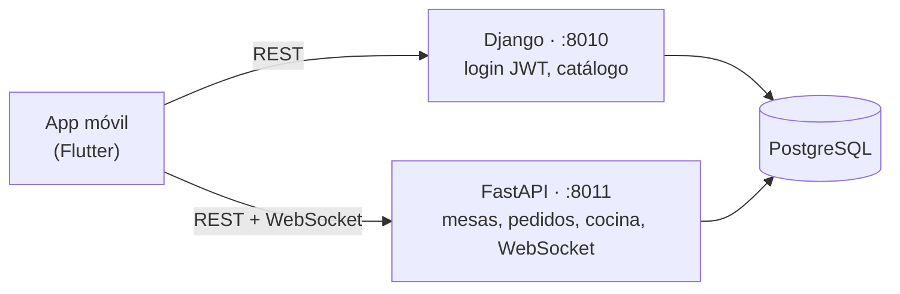
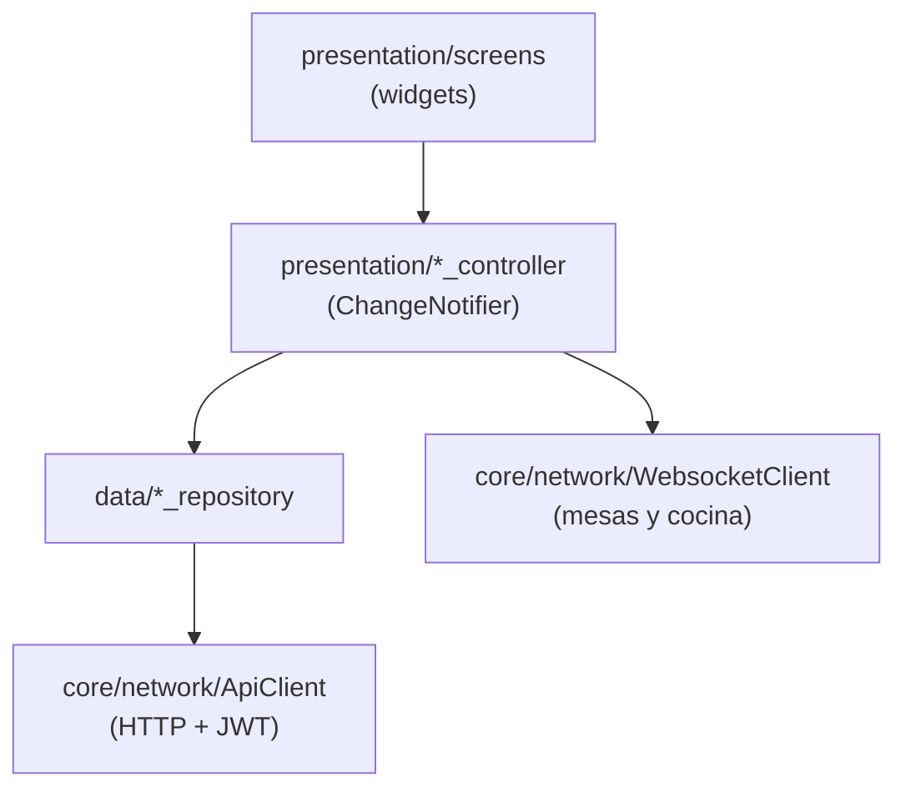
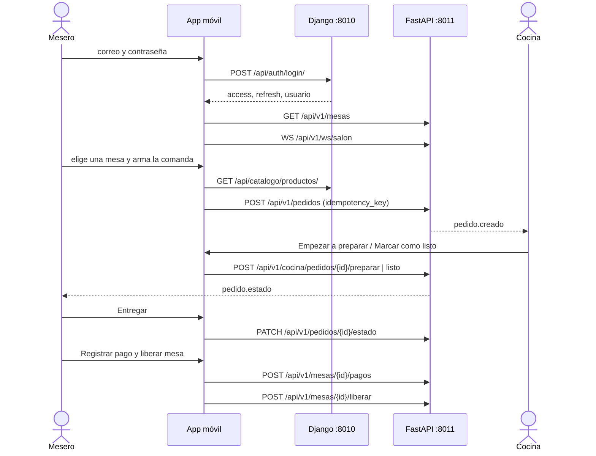

# app movil  para meseros y cocina

App móvil para meseros y cocina del **Sistema de Gestión para Restaurantes**: el mesero toma pedidos desde la mesa, cobra la cuenta y libera la mesa; la cocina sigue su cola en un tablero que se actualiza en vivo.


## Contenido

- [Resumen](#resumen)
- [Capturas](#capturas)
- [Características](#características)
- [Tecnologías](#tecnologías)
- [Arquitectura](#arquitectura)
- [Flujo de funcionamiento](#flujo-de-funcionamiento)
- [Requisitos previos](#requisitos-previos)
- [Instalación y ejecución](#instalación-y-ejecución)
- [Configuración](#configuración)
- [API consumida](#api-consumida)
- [Estructura del proyecto](#estructura-del-proyecto)
- [Calidad y pruebas](#calidad-y-pruebas)
- [Limitaciones conocidas](#limitaciones-conocidas)
- [Autor y licencia](#autor-y-licencia)

## Resumen

Esta app es el cliente móvil de un sistema con **dos backends** (Django y FastAPI) sobre una base PostgreSQL compartida. Cubre el circuito de sala:

1. El mesero ve el salón en tiempo real y arma la comanda de una mesa.
2. La cocina recibe el pedido sin recargar y lo avanza de estado.
3. El mesero entrega, registra los pagos (con opción de dividir la cuenta) y libera la mesa.

Comparte identidad visual con el panel web del mismo sistema (`frontend_restaurante/`): mismo motivo de azulejo y misma paleta chicha / ají / limón / rocoto.

Forma parte de un sistema mayor que vive en el directorio padre; ver su [README](../README.md) para levantar el resto de servicios.

> **Pendiente:** si esta app se publica como repositorio independiente, el enlace `../README.md` dejará de resolverse; sustituirlo por la URL del repositorio del sistema completo.

## Capturas

> **Pendiente:** el repositorio no incluye capturas ni demo. Sugerencia: guardarlas en `docs/screenshots/` y enlazarlas aquí (acceso, salón, nuevo pedido, cuenta de mesa, tablero de cocina).

## Características

### Por rol

La barra inferior y las rutas dependen del rol que viene en el JWT (`lib/routes/app_router.dart`). Un mesero que intenta abrir `/cocina` es redirigido, y viceversa.

| Rol | Qué puede hacer |
|---|---|
| **mesero** | **Salón** con mesas en vivo (estado, capacidad y consumo en curso) · **Nuevo pedido** con carta por categorías, búsqueda y carrito · **Mis pedidos** (últimos 50 propios) con acción *Entregar* cuando el plato está listo · **Cuenta de mesa** (ver más abajo) |
| **cocina** | Tablero de tres pestañas: *En espera*, *Preparando* y *Listos*, con contador por pestaña. El pedido avanza desde su propia tarjeta (*Empezar a preparar* → *Marcar como listo*) |
| **admin** | Ve las vistas de mesero y de cocina. Es el único rol al que la app ofrece *Liberar sin cobrar* (la app pide un motivo) |

**Cuenta de mesa.** Al tocar una mesa ocupada se abre su cuenta: total, pagado y saldo; pedidos y pagos registrados; cobro en efectivo, tarjeta o Yape; monto sugerido al dividir entre 1 y 12 comensales; *Agregar platos a la mesa*. Con el saldo en cero se habilita *Liberar mesa*. Tocar una mesa no ocupada abre una comanda nueva.

### Transversales

- **Sesión persistente** con JWT emitido por Django, renovación automática ante un `401` y restauración del perfil al abrir la app.
- **Pedidos sin duplicados** mediante clave de idempotencia (ver [Decisiones de diseño](#decisiones-de-diseño)).
- **Tiempo real** por WebSocket con indicador *en vivo* / *reconectando*.
- **Formato regional**: `Locale('es')` y montos en soles (`S/ 1,234.50`).
- **Alerta de demora**: las comandas con 15 minutos o más sin estar listas resaltan en rojo.

### Interfaz y animaciones

- `AparicionEscalonada`: las tarjetas entran con un retardo según su posición.
- `PulsoAtencion`: halo intermitente sobre el pedido que acaba de llegar a cocina.
- Barra del carrito con `AnimatedSlide`, contadores con `AnimatedSwitcher` y transición del botón *Entregar*.
- Plano de cada mesa (redonda hasta 4 puestos, rectangular si son más) y azulejo dibujados con `CustomPainter`.

## Tecnologías

| Área | Tecnología | Uso |
|---|---|---|
| Framework | Flutter 3.24 · Dart `^3.5.2` | UI Material 3 (`useMaterial3: true`) |
| Estado | `provider` `^6.1.2` | `ChangeNotifier` por feature |
| Navegación | `go_router` `^14.2.7` | `ShellRoute` y redirección según rol |
| HTTP | `http` `^1.2.2` | Cliente REST compartido para ambos backends |
| Tiempo real | `web_socket_channel` `^3.0.1` | Canales `cocina` y `salon` de FastAPI |
| Persistencia local | `shared_preferences` `^2.3.2` | Tokens de sesión |
| Formatos e i18n | `intl` `^0.19.0` · `flutter_localizations` | Fechas y moneda en español |
| Calidad | `flutter_lints` `^4.0.0` | `flutter analyze` |
| Build Android | Gradle 8.4 · AGP 8.3.0 · Kotlin 1.9.10 | Configuración en `android/` |

**Backends que consume** (según el README del sistema completo): Django 5 + DRF (usuarios, JWT y catálogo) y FastAPI + SQLAlchemy async (mesas, pedidos, cocina y WebSocket).

## Arquitectura



Cada feature separa `data/` (repositorio HTTP) de `presentation/` (`ChangeNotifier` + pantallas):



Los repositorios reciben el `ApiClient` por constructor, lo que permite sustituirlo por un doble en pruebas sin tocar la UI.

### Decisiones de diseño

- **JWT compartido.** `ApiClient` guarda el token emitido por Django y lo reenvía tanto a Django como a FastAPI, que validan con el mismo secreto. Ante un `401` intenta renovar una sola vez con `/api/auth/refresh/` y reintenta la petición. Las peticiones tienen un tiempo límite de 15 s.
- **Idempotencia de pedidos.** `PedidosController` genera la clave (UUID v4) al **abrir** el carrito, no al enviarlo. Si el envío falla por red y el mesero reintenta, viaja la misma clave y el backend devuelve el pedido ya existente en lugar de crear un duplicado. La clave solo se renueva al empezar una comanda nueva.
- **Tiempo real.**
  - *Cocina* abre el canal `cocina` y recarga el tablero al recibir `pedido.creado`, `pedido.estado` o `pedido.linea.estado`.
  - *Salón* abre el canal `salon` y recarga al recibir `pedido.creado`, `pedido.estado`, `mesa.estado` o `pago.registrado`; si el canal está caído, refresca cada 15 s como respaldo.
  - Si la conexión se pierde, `WebsocketClient` reintenta automáticamente y la insignia pasa de *en vivo* a *reconectando*.
- **Errores unificados.** `ApiError` normaliza los formatos de error de DRF y FastAPI (`detail`, `errors`) y aplica mensajes por código HTTP cuando el cuerpo no trae detalle.
- **Roles.** `Usuario.esMesero` y `Usuario.esCocina` se derivan del rol; `admin` cumple ambos.

## Flujo de funcionamiento



Ciclo de estados del pedido: `pendiente → preparando → listo → entregado` (`cancelado` existe como estado, pero la app no ofrece cancelar).

## Requisitos previos

- **Flutter 3.24 o superior** (Dart 3.5.2+). Verificado con Flutter 3.24.2.
- **Android Studio / Android SDK** y un emulador o dispositivo con depuración USB (para Android). Chrome, si se ejecuta en web.
- **Backends en ejecución**: Django en el puerto 8010, FastAPI en el 8011 y PostgreSQL. Los pasos están en el [README del sistema completo](../README.md), cuyo directorio incluye también un `docker-compose.yml` con la base de datos, ambos backends y el panel web.

## Instalación y ejecución

```bash
git clone <URL-DEL-REPOSITORIO>       # pendiente: URL del repositorio
cd frontend_movil_restaurante         # subcarpeta de la app dentro del sistema completo

flutter pub get
flutter run
```

`flutter run` usa el dispositivo o emulador disponible; con varios conectados, indicar uno con `-d <id>`.

La pantalla de acceso muestra dos cuentas de demostración (mesero y cocina). Se crean con `python manage.py seed_demo` en el backend Django; sus credenciales están en el README del sistema completo y no se reproducen aquí.

## Configuración

La app no usa archivos `.env`. La única variable es `API_HOST`, que se pasa en tiempo de compilación con `--dart-define`. `lib/config/env.dart` resuelve el host según el destino:

| Destino | Host | Comando |
|---|---|---|
| Emulador Android | `10.0.2.2` (automático) | `flutter run` |
| Web | `localhost` (automático) | `flutter run -d chrome` |
| Dispositivo físico | el que se indique | `flutter run --dart-define=API_HOST=192.168.1.50` |

| Variable | Obligatoria | Valor por defecto | Descripción |
|---|---|---|---|
| `API_HOST` | No | `10.0.2.2` en Android, `localhost` en el resto | Host del equipo donde corren los backends |

URLs derivadas (los **puertos están fijos** en `env.dart`): `http://<host>:8010` (Django), `http://<host>:8011` (FastAPI) y `ws://<host>:8011` (WebSocket).

**Notas según el destino**

- **Dispositivo físico:** debe estar en la misma red que el equipo, y los backends deben escuchar en una interfaz accesible desde ella (por ejemplo `runserver 0.0.0.0:8010` y `uvicorn ... --host 0.0.0.0 --port 8011`).
- **Web:** el navegador aplica CORS. El origen del servidor de desarrollo de Flutter debe figurar en `CORS_ALLOWED_ORIGINS` (Django) y `CORS_ORIGINS` (FastAPI). Conviene fijar el puerto, por ejemplo `flutter run -d chrome --web-port=5175`, y permitir `http://localhost:5175`.
- **Ambos backends** deben compartir el mismo `JWT_SECRET`; si difieren, el login funciona pero FastAPI responde `401` (ver el README del sistema completo).

## API consumida

Todas las peticiones llevan `Authorization: Bearer <access>`. Las rutas se verificaron contra el código de ambos backends.

**Django** (`:8010`)

| Método | Ruta | Uso |
|---|---|---|
| `POST` | `/api/auth/login/` | Acceso; devuelve `access`, `refresh` y `usuario` |
| `POST` | `/api/auth/refresh/` | Renovación del token de acceso |
| `GET` | `/api/auth/perfil/` | Restaurar la sesión al abrir la app |
| `GET` | `/api/catalogo/productos/?page_size=200&activo=true` | Carta activa |

**FastAPI** (`:8011`, prefijo `/api/v1`)

| Método | Ruta | Uso |
|---|---|---|
| `GET` | `/mesas` | Salón: mesas con pedidos activos y total en curso |
| `GET` | `/mesas/{id}/cuenta` | Cuenta de la mesa |
| `POST` | `/mesas/{id}/pagos` | Registrar un pago (`metodo`, `monto`, `referencia_externa` opcional) |
| `POST` | `/mesas/{id}/liberar` | Liberar la mesa (`forzar`, `motivo` opcional) |
| `GET` | `/pedidos?solo_mios=true&limite=50` | Pedidos del mesero |
| `POST` | `/pedidos` | Crear pedido (`mesa_id`, `idempotency_key`, `lineas`) |
| `PATCH` | `/pedidos/{id}/estado` | Cambiar estado (la app lo usa para *entregado*) |
| `GET` | `/cocina/tablero` | Pedidos agrupados por estado |
| `GET` | `/cocina/metricas` | Se consulta al cargar el tablero; aún no se muestra en pantalla |
| `POST` | `/cocina/pedidos/{id}/preparar` | Pasar a *preparando* |
| `POST` | `/cocina/pedidos/{id}/listo` | Pasar a *listo* |
| `WS` | `/ws/{canal}?token=<access>` | Eventos en vivo; canales `cocina` y `salon` |

## Estructura del proyecto

```text
lib/
├── main.dart                         # arranque; inicializa el formato de fechas 'es'
├── app.dart                          # MultiProvider y MaterialApp.router
├── config/
│   └── env.dart                      # host y puertos de los backends
├── core/
│   ├── constants/estados.dart        # estados, métodos de pago, rótulos y colores
│   ├── network/
│   │   ├── api_client.dart           # JWT compartido, refresco y errores
│   │   └── websocket_client.dart     # canal en vivo con reconexión
│   ├── theme/app_theme.dart          # paleta y tema Material 3
│   └── utils/formato.dart            # soles, horas y antigüedad
├── features/                         # cada una con data/ y presentation/
│   ├── auth/                         # login y sesión
│   ├── mesas/                        # salón y cuenta de mesa
│   ├── pedidos/                      # nuevo pedido y mis pedidos
│   └── cocina/                       # tablero de cocina
├── routes/app_router.dart            # rutas y redirección por rol
└── shared/
    ├── models/modelos.dart           # Usuario, Mesa, Producto, Pedido, CuentaMesa…
    └── widgets/
        ├── comunes.dart              # Azulejo, Insignia, animaciones y estados vacíos
        └── concha.dart               # shell con barra inferior y menú lateral
```

## Calidad y pruebas

```bash
flutter analyze
```

- El análisis estático (`flutter_lints`) se ejecutó con Flutter 3.24.2 y no reportó incidencias.
- **No hay pruebas automatizadas todavía:** el directorio `test/` está vacío aunque `flutter_test` figura como dependencia de desarrollo.

## Limitaciones conocidas

- **Sin pruebas automatizadas** (ver arriba).
- **Build de release no configurado:** `android/app/build.gradle` firma el release con las claves de depuración (hay un `TODO` en el archivo); además el permiso `INTERNET` solo está declarado en los manifiestos `debug` y `profile`, no en el principal.
- **Solo Android y Web:** el proyecto no incluye `ios/` ni carpetas de escritorio. La ejecución en web no se verificó en esta revisión.
- **Seguridad para producción:** las URLs son `http://` y `ws://` fijas, los tokens se guardan en `shared_preferences` y el WebSocket recibe el token por query string. Antes de desplegar conviene usar HTTPS/WSS y almacenamiento seguro.
- **Notas por plato:** el modelo, el repositorio y el tablero de cocina las soportan, pero la pantalla de pedido aún no ofrece un campo para escribirlas.
- **Rol `inventario`:** existe en el sistema, pero se usa en el panel web; la app móvil no tiene pantallas para él.

## Autor y licencia

- **Autor:** _pendiente — completar nombre y enlace de perfil._
- **Licencia:** _pendiente — el repositorio no incluye archivo `LICENSE`._
